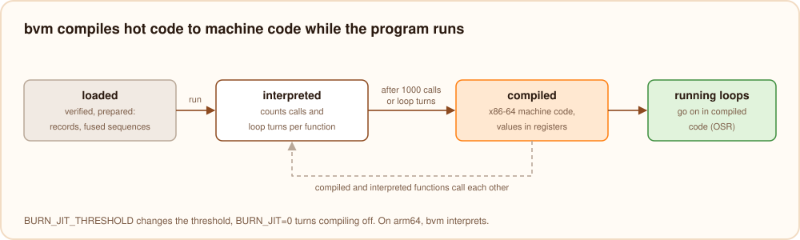

# The JIT

bvm gets faster as a program runs. It starts every function in the interpreter, counts how often each one is called
and how often its loops turn, and compiles the hot ones to machine code (x86-64 or arm64) while the program keeps running. There
is nothing to configure and no cache on disk, and it works for every language built on bvm, not just Burn.

## Preparing: the interpreter

When a module is loaded, bvm verifies it and prepares every function once: each instruction becomes a fixed-size
record of 32 bytes in memory, with its jump target, the function it calls, its string or its runtime function already
resolved to an address, so nothing is looked up while the program runs. Common sequences are fused into single
records, such as "add a constant to a local" (`i += 1`), "compare two locals and jump", "load a local and a constant"
or "load a local and read one of its fields". The interpreter is a loop over these records, with the locals of a call
and its operand stack next to each other in one block of memory.

## Compiling: hot code becomes machine code

Each function counts its calls and the backward jumps of its loops. At 1000 the interpreter hands the function to the
JIT, which writes machine code for it from the prepared records into memory it maps executable:

- **The same frame.** Compiled code keeps the interpreter's layout: the locals of a call and its operand stack at a
  fixed place, each stack slot at a fixed offset. Interpreted and compiled functions call each other freely, in any
  order, and a call to a compiled function from compiled code is a plain machine `call`.
- **On-stack replacement.** A loop that gets hot in the middle of a call, such as a long loop in `main`, does not wait
  for the next call: the interpreter jumps into the compiled code at the same instruction and the loop goes on there.
- **Values in registers.** While it compiles, the JIT tracks what each operand stack slot holds: a constant, the value
  of a local, or the value in a register. It writes a value to memory only where a jump, a call or a jump target needs
  it there, so `total += i % 7` is a handful of register instructions.
- **Inline fast paths.** Integer arithmetic with its overflow checks, comparisons fused with the branch after them,
  division, fields, array reads and writes, `len` and reference counting are machine instructions. They call the
  runtime only for their rare cases: a division by 0, an index out of bounds, an object that dies, values shared
  between threads.
- **Everything else** runs the same function the interpreter uses for it, so compiled code never behaves
  differently.

Runtime errors, `exit`, the REPL's recovery from errors and stack overflows behave the same in compiled code: the
error names the same line and column. Threads started with `async` share the compiled code.

## Settings

| Variable | Does |
| --- | --- |
| `BURN_JIT=0` | turns the JIT off; everything is interpreted |
| `BURN_JIT_THRESHOLD=<n>` | how many calls or loop turns make a function hot (default 1000); `1` compiles every function on its first call |

The results are always the same; only the speed changes. Burn's test suite runs every test program with
`BURN_JIT_THRESHOLD=1` and with `BURN_JIT=0` and compares their output with the native executables.

The JIT runs on Linux and macOS, on x86-64 (`compiler/src/bvm/jit_x86.bn`) and arm64, Macs with Apple silicon
included (`jit_arm64.bn`). Both code generators share the tracking of the operand stack and jumps (`jitbase.bn`).
On arm64 the accumulator is `x9` and the frame base `x19`; on x86-64 they are `rax` and `rbx`.

## Numbers

Measured on x86-64 Linux:

| Program | Interpreted | With the JIT | Native executable |
| --- | --- | --- | --- |
| `fib(32)`, recursive calls | 1.4 s | 31 ms | 20 ms |
| a loop with `%` over 50 million numbers | 4.6 s | 0.17 s | 0.17 s |
| 30 million loop turns at the top level | 3.7 s | 0.05 s | 0.08 s |
| a sieve of Eratosthenes over arrays | 6.0 s | 0.9 s | 0.75 s |
| structs created and read in a loop | 2.2 s | 0.86 s | 0.77 s |

The times include starting `burn`, compiling the program to bytecode and compiling it to machine code.
