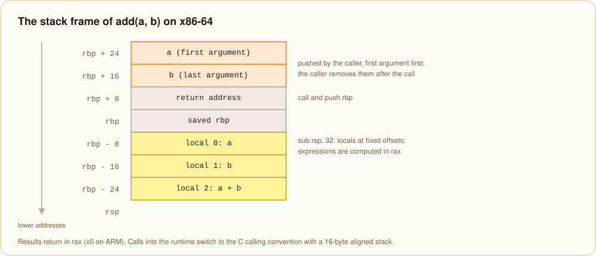

# Native executables

`burn build` (and `burnc`) turns a program into a standalone executable for the machine: x86-64 or 64-bit ARM, on
Linux or macOS. It starts from the same IR as bvm, after the [ownership pass](./memory.mdx), and generates assembly
text that the system's C compiler assembles and links.

```text
IR ──▶ compiler/src/native/x86.bn or arm64.bn ──▶ app.s ──▶ cc ──▶ app
                                                            ▲
                                       share/burn/lib/libburn_runtime.a
```

`burn dump --asm app.bn` prints the assembly, and `burn build --emit-asm app.s` keeps it next to the executable.

## A function

```burn
fun add(a: int, b: int): int {
    return a + b
}
```

becomes, on x86-64:

```text
bf_1:
    push rbp
    mov rbp, rsp
    sub rsp, 32
    mov rax, qword ptr [rbp + 24]     ; a
    mov qword ptr [rbp - 8], rax
    mov rax, qword ptr [rbp + 16]     ; b
    mov qword ptr [rbp - 16], rax
    mov rax, qword ptr [rbp - 8]
    mov rcx, qword ptr [rbp - 16]
    add rax, rcx
    jo .L9                            ; integer overflow?
    mov qword ptr [rbp - 24], rax
    mov rax, qword ptr [rbp - 24]
    leave
    ret
.L9:
    mov edi, 1                        ; location id of `a + b`
    and rsp, -16
    call burn_err_overflow@PLT
    ud2
```



- **Functions** are labeled by number (`bf_1`); `--no-strip` keeps these labels in the symbol table.
- **Arguments** are pushed on the stack by the caller, first argument first, so the last one is closest to the
  callee's frame; the caller removes them after the call. Results come back in `rax` (`x0` on ARM).
- **Locals** live in the stack frame at fixed offsets. Expressions are evaluated into `rax`/`x0`, with intermediate
  values pushed on the stack.
- **Checks** are inline: overflow is a `jo` (on ARM, the flags after `adds`/`subs`, or a widening multiply),
  bounds checks compare with the length stored in the array, null checks test for zero. The error path is placed
  after the function and calls the runtime with the location id, so the fast path has no extra jumps.
- **Calls into the runtime** (`burn_print`, `burn_to_str`, `burn_str_concat`, ...) use the platform's C calling
  convention, with the stack aligned to 16 bytes.
- **Reference counting** is inlined: a retain or release is a null test, a static test, a test of the
  multi-threaded flag and an increment or decrement of the count at offset 12. Only freeing and the cycle check call
  into the runtime ([memory management](./memory.mdx#retain-and-release-at-runtime)).
- **Fields and array elements** are read with one instruction after the checks, at the offsets described in
  [values in memory](./values.mdx).
- **Interface calls** load the object's type id, index the dispatch table and call through it.

The ARM generator (`arm64.bn`) produces the same structure with ARM instructions: results in `x0`, the second operand
in `x1`, locals relative to the frame pointer `x29`, addresses formed with `adrp`/`add`, constants built with
`movz`/`movk`. Both generators share the data layout, the argument order and the decisions about what a program
exports (`native/shared.bn`), so one runtime library serves both.

## Startup

The executable's `main` is generated too. It passes the runtime everything it needs and then runs the program:

1. `burn_rt_init` receives the program's metadata (its type table and location table, encoded as bytes in the
   read-only data section), its globals, the address of the stack and the trampoline described below. The runtime
   builds its type information, installs the stack overflow handler (on Linux x86-64) and marks the main thread.
2. `burn_rt_set_args` stores the command line arguments for `args()`.
3. `burn_entry` runs the top level code of every module in order, then `main`.
4. `burn_rt_exit(0)` waits for async tasks, flushes the output and exits.

Globals live in the `.bss` section, one word each. String literals are complete string objects in the read-only data
section, header included, with the static flag set, so they are never allocated, counted or freed:

```text
bs_1:
    .byte 1, 0, 3, 0        ; kind string, flags static and ASCII
    .long 6                 ; type id: string
    .long 28, 0             ; size, reference count
    .quad 3                 ; length
    .byte 104,105,32,0      ; "hi "
```

## The trampoline

The runtime sometimes has to call a Burn function of the program: to start an async task, or to run a closure that
was passed to it. Burn functions take their arguments on the stack, which a function with the C calling convention
cannot set up, so every executable contains a short generated function, `burn_call_trampoline(f, args, n)`, that
pushes the `n` arguments and calls `f`. The runtime calls the program's code only through it. (Functions marked
[`@Extern`](../language/calling-c.mdx) are different: they take their arguments the C way, so C can call them
directly.)

## Inline assembly

An [`asm` block](../language/inline-assembly.mdx) has its `x86_64` or `arm64` code copied into the function as
written. Before it, the code generator stores every operand in a slot of the frame, and `{x}` becomes that slot's
address (`qword ptr [rbp - 24]` or `[x29, #16]`); after it, the slots are copied back into the variables. Nothing in
the generated code keeps a value in a register from one statement to the next, which is why the block may use the
caller-saved registers freely.

## Linking

The generated assembly is linked by the C compiler (`cc`, or `BURN_CC`/`CC`) with:

- `libburn_runtime.a`, the runtime written in Burn (`lib/rt`), compiled to native code, so the executable needs no
  Burn installation;
- the system libraries listed in `native-libs.txt` next to it (the C library, threads, math);
- for programs that run bytecode, `libburn_launcher.a`, bvm written in Burn (see below).

The libraries are built by `scripts/native-runtime.sh` with the toolchain's own `burn` and shipped in
`share/burn/lib`. Every function is in a section of its own on Linux, so the linker drops the code nothing uses
(`--gc-sections`). The executable is stripped unless `--no-strip` is given. Hello world comes out at about 220 KB on
x86-64 Linux.

## Bytecode inside native executables

A program that imports bytecode libraries (`.bvmc`) is compiled to bytecode instead, linked with its libraries and
embedded in an executable together with bvm (`libburn_launcher.a`, built from `compiler/src/bin/launcher.bn`), which
runs it at startup. The program therefore behaves exactly as on bvm, mixins included, and its hot code is compiled
by [the JIT](../bvm/optimizing.mdx). `burn build app.bar` (or `.bvm`, `.bvmc`) makes such an executable from
bytecode directly.

## Cross-compiling

Code generation only depends on the target platform, which `BURN_PLATFORM` selects (`linux-x86_64`,
`macos-x86_64`, `linux-aarch64`, `macos-aarch64`). Linking needs a runtime library and a linker for that platform:
`BURN_RUNTIME_DIR` and `BURN_CC`. See [cross-compiling](../tooling/cross-compiling.mdx).

## Stack overflow

The runtime catches a stack overflow with a signal handler running on its own small stack and prints
`runtime error: stack overflow (recursion is too deep)` before exiting with `1`, on Linux and macOS, x86-64 and
arm64.
