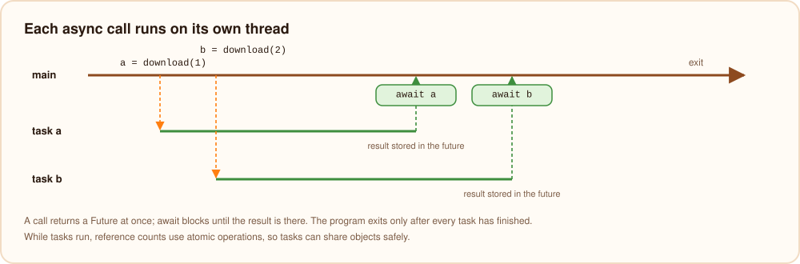

# Running on bvm

`burn app.bn`, `burn run` and `burni` run programs on bvm, the Burn virtual machine. bvm is a general-purpose stack
machine written in Burn ([bvm overview](../bvm/overview.mdx)), compiled into the `burn` executable; this page follows
a Burn program through it.

## Linking

The compiler's module contains only the program. Its `rt` instructions name runtime functions, such as `split`,
`trim`, `contains`, `parseJSON` or `toInt`; when the module is prepared, each one is resolved to the address of the
function in the runtime written in Burn (`lib/rt/`), which is compiled into the toolchain, so an `rt` instruction is a
direct call.

Bytecode libraries imported by the program (`.bvmc`) are linked first: functions are matched by name, dispatch tables
with the same name are merged, and [mixins](../bvm/mixins.mdx) are applied to their targets.

## Verifying

Before anything runs, the verifier checks every function: jumps stay inside the function, every path reaches each
instruction with the same stack height, the stack never underflows or grows past 65,536 slots, locals and globals
exist, types and dispatch tables refer to real types, and direct calls pass the number of arguments the callee
takes (calls through function values are checked when they happen). A
module that fails is rejected with a message naming the function and instruction, so the interpreter can skip these
checks while running.

## The interpreter

Each call gets a frame with its locals, followed by its operand stack; values are 64-bit words. Instructions are small
and typed (`iadd`, `fadd`, `getfield`, `index`, `call`, `dispatch`, `rt`), so most do one thing without looking at
types.

Before the program starts, every function is prepared once: each instruction becomes a fixed-size record in memory,
with its jump target, called function, string or runtime function already resolved to an address, and common
sequences are fused into superinstructions, such as "add a constant to a local" (`i += 1`), "compare two locals and
jump", or "load a local and read one of its fields". The interpreter is a loop over these records.

## Compiling hot code

bvm counts calls and loop turns per function. When a function gets hot (1000 calls or loop turns), the JIT compiles
it to x86-64 machine code that keeps the interpreter's frame, so compiled and interpreted functions call each other
freely, and a loop that is already running continues in the compiled code at its next turn (on-stack replacement).
Compiled code keeps values in registers and runs arithmetic, comparisons, fields, arrays and reference counting
inline. See [the JIT](../bvm/optimizing.mdx) for the details and its settings, `BURN_JIT` and `BURN_JIT_THRESHOLD`.


## Runtime errors

Every instruction that can fail (an index, a division, an overflow check, a cast, a `!!`, a map lookup) carries a
location id. The module has a table of locations, written by the compiler as `file:line:column`. When an operation
fails, the runtime looks up the location, reads that line from the source file, and prints:

```text
runtime error: index 5 out of bounds (length 1)
 --> app.bn:2:7
  |
2 | print(a[5])
  |       ^
  = help: valid indexes go from 0 to 0; check the index against `len(...)` first
```

Then it flushes the program's output and exits with code `1`. When the source file is no longer there (for example
a `.bvmc` copied elsewhere), the location line is printed without the snippet.

Deep recursion is caught too: bvm keeps its frames in its own memory and stops a program that goes deeper than about
a million calls with `runtime error: stack overflow (recursion is too deep)`. Compiled code also uses the machine
stack, so a compiled function stops with the same error once its calls use 4 MB of it.

## Async tasks

`spawn` starts an async call on a new operating system thread and returns a future; each task gets an interpreter of
its own, and the threads share the program's code, including code that has already been compiled. `await` blocks until the task has stored its
result. While tasks run, reference counting switches to atomic operations
([memory management](./memory.mdx#async-tasks-and-threads)). A runtime error in a task stops the whole program like
one in the main thread. When the main program ends, bvm waits for the tasks that are still running, then exits.



## Output

`print` writes to a buffer instead of making a system call per line. On a terminal the buffer is written out at every
line break, so output appears as it is printed; when the output goes to a file or a pipe, it is written in blocks of
64 KB. The buffer is also flushed before `eprint`, before reading input, sleeping or running another process, before
a runtime error is printed and at exit, so output always appears in order and complete.

## Host functions

A program that bvm runs inside another program can call functions the host provides, declared in Burn with
`@Native("name")` ([native interop](../bvm/native-interop.mdx)). The Burn command line does not need them: it has bvm
compiled in, so it compiles a program to a module and runs it by calling bvm directly, without starting a new process
([the toolchain](./toolchain.mdx)).
