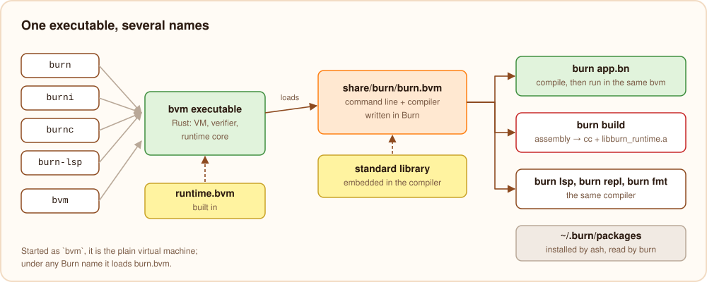
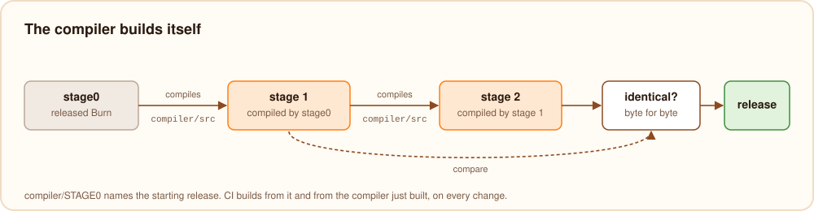

# The toolchain

## One executable, several names

An installed toolchain looks like this:

```text
~/.burn/
├── bin/
│   ├── bvm              the Burn virtual machine
│   ├── burn             the same executable as bvm
│   ├── burni -> burn
│   ├── burnc -> burn
│   ├── burn-lsp -> burn
│   └── burnfmt          a script: burni share/burn/tools/fmt.bn "$@"
└── share/burn/
    ├── burn.bvm         the command line, compiled to bytecode
    ├── tools/fmt.bn     the formatter
    └── lib/             the runtime library for native executables
```



`burn`, `burni`, `burnc` and `burn-lsp` are all bvm. When bvm starts, it looks at the name it was started with. As
`bvm`, it is the plain virtual machine with its own commands (`bvm app.bvmc`, `bvm asm`, `bvm link`, ...). As one of
the four Burn names, it loads `share/burn/burn.bvm` from next to its `bin` folder (or the file `BURN_CLI_BVM` names)
and runs it, passing along the name. The command line, written in Burn (`compiler/src/bin/burn.bn` and
`compiler/src/cli/`), then behaves as `burn`, as the interpreter `burni`, as the compiler `burnc`, or as the language
server.

## How the command line runs programs

The command line contains the whole compiler. To run a program, it checks and compiles it to a bvm module, then asks
the bvm it is running on to run that module, through host functions: functions bvm provides to the program it runs,
declared in Burn with `@Native` (`compiler/src/cli/host.bn`):

| Host function | Does |
| --- | --- |
| `burn.runModule` | assemble, link and run a compiled module in the same process, with arguments |
| `burn.runFile` | run a `.bvmc` or `.bar` file |
| `burn.writeBytecode`, `burn.writeArchive` | write a module as `.bvmc`, or an archive as `.bar` |
| `burn.library`, `burn.libraryFunctions` | read the exported functions of a bytecode library being imported |
| `burn.replStart`, `burn.replEval`, `burn.replReset` | keep a REPL session's module and globals between inputs |
| `burn.lspStart`, `burn.readMessage`, `burn.send` | read and write language server messages |
| `burn.platform`, `burn.shareDir`, `burn.bundle` | what native builds need: the target, the runtime library, embedded bytecode |

So `burn app.bn` never starts a second process: one bvm runs the compiler and then the program. The program gets its
own memory bookkeeping (its own buffer of cycle candidates, for example), so the compiler's objects and the program's
never mix.

`burn build` produces assembly in Burn and then does start one process: the C compiler, to assemble and link
([native executables](./native.mdx)).

## The standard library and the runtime

- **The standard library** (`lib/std/*.bn`) is embedded into the compiler as source text
  (`compiler/src/project/stdlib.bn`, generated by `compiler/src/bin/genstd.bn`), so `import "std/strings"` never
  reads a file and always matches the compiler. `burn sources` writes these sources to disk for editors.
- **The runtime library written in Burn** (`lib/runtime/*.bn`) is compiled to `bvm/runtime.bvm` and built into the
  bvm executable, which links it into every Burn program it runs.
- **The runtime core** (`bvm/runtime/src`) is Rust, compiled into bvm and into `share/burn/lib/libburn_runtime.a` for
  native executables.

The repository's tests check that the generated runtime library, JavaScript runtime and `burn doc` assets are up to
date with their sources.

## Packages

A project's `burn.toml` lists its dependencies, and `burn.lock` pins each to an exact revision. Installed packages
live in `~/.burn/packages` (or `$BURN_HOME/packages`), one folder per package and revision:

```text
~/.burn/packages/github.com/ada/colors@3f2a9c1d0b7e/
```

The compiler only reads these folders; [ash](../tooling/packages.mdx) downloads and updates them. A dependency given
by path (`{ path = "../shared" }`) is read from that folder directly. Because the revision is part of the folder name,
projects that use different versions of a package never interfere.

## The language server

`burn lsp` (or `burn-lsp`) is the command line in language server mode. For every change in the editor it runs the
front end of the compiler on the open files, with an index of what each name refers to, and answers hovers,
completions, go-to-definition, references, renames and diagnostics from it. Because it is the same compiler, the
editor shows exactly the errors `burn check` would. On Linux the server limits its own memory to 4 GB
(`BURN_LSP_MEMORY_MB` changes it, `0` removes the limit), so a runaway analysis stops the server, not the machine.

## The REPL

The REPL keeps the code entered so far. Each new input is checked together with it, compiled to a small module and
run by bvm with the session's globals kept, so variables, functions and types survive between inputs. `:source`
prints the accumulated code.

## How the compiler builds itself

The compiler is a Burn program, so it needs a Burn compiler to build. That compiler is in the repository:
`compiler/boot/compiler.bvmc` is the compiler from an earlier commit, compiled to bvm bytecode, the way Zig keeps
`zig1.wasm`. Only Rust is needed to start. Building Burn (`scripts/package.sh`, or `scripts/bootstrap.sh`) builds bvm
with cargo and then:



1. lets bvm run the boot compiler, which compiles `compiler/src`, giving stage 1;
2. compiles `compiler/src` again with stage 1, giving stage 2;
3. checks that stage 1 and stage 2 are the same module, byte for byte. When they are not, because the code generator
   changed since the boot compiler was made, stage 2 compiles `compiler/src` once more, and stage 2 and stage 3 must
   be the same.

The last step proves that the compiler, compiled by itself, produces exactly what it was compiled from, so a release
does not depend on quirks of the compiler that built it. The command line, the formatter and the runtime library are
then compiled with the new compiler, and the result is packaged. CI runs this on every change.

`compiler/src` may only use language features that the boot compiler understands. To use a new one in the compiler,
the feature lands first; then `sh scripts/bootstrap.sh --update` replaces the boot compiler with the compiler just
built, and the first use comes with it. Until `26.1.0-experimental-4`, a released Burn (stage0) started the bootstrap
instead, which meant cutting a release before the compiler could use anything new.
